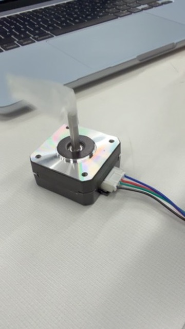
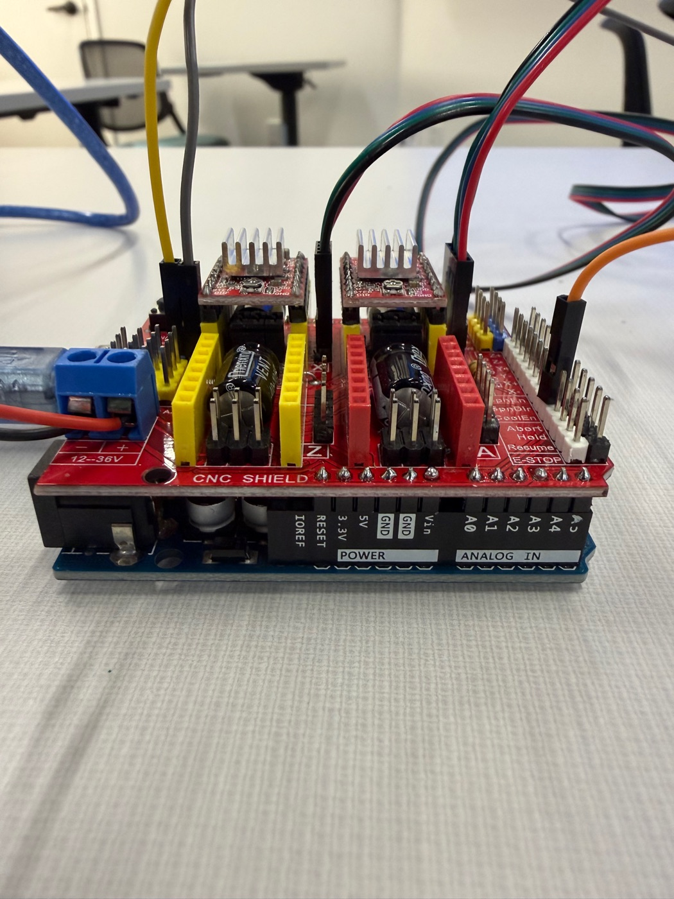

# 11-19-26 · 3D Scanner: The Whole Year in One Journal

## Overview

This journal is the full record of what my partner and I did on the 3D scanner this year in Tech and Innovation Seminar II, from the first stepper motor in the fall through to where it is now.

We started the year with a servo, an ultrasonic sensor and a stepper we couldn't get to turn. We ended it with a two-motor pan-tilt scanner that sweeps an infrared sensor across an object, plus a web page that turns the readings into a 3D image you can spin around. That page is live at **[kfidak13.github.io/RLK](https://kfidak13.github.io/RLK/)**, so anyone with the link and the hardware can use it.

<video controls muted playsinline preload="metadata" width="360" src="videos/scanner-scan-in-progress.mp4"></video>

*A real scan in progress: the scanner sweeps while points appear in the 3D view, row by row.*

## Motivating questions

Can a cheap distance sensor give readings steady enough to build a shape out of?

What does it take to move a sensor precisely enough that the points line up?

How do you turn a list of angles and distances into a 3D image?

When something doesn't work, how do you tell whether it's the code, the wiring or the power?

## The year at a glance

| When | What happened |
|---|---|
| Last year | Tested a small IR sensor at known distances and got a stepper moving a few degrees at a time ([last year's journal](3d%20Scanner.html)) |
| September to October | Servo and ultrasonic sensor working, readings turned into coordinate points, then a stepper motor turning after a fight with the breadboard |
| Early November | Built the pan-tilt mount with two steppers, moved to a CNC shield, and wrote the first version of the scanning software |
| Mid November | Motors moving, our own scanning sketch, the first real scans, and a simpler page |
| After that | Scan settings, a public link for the team, a filter for background clutter, and a button that updates the Arduino from the page |

## Part 1: From servos to steppers

We rebuilt the scanner piece by piece instead of jumping straight to the finished thing.

1. **Servo and ultrasonic sensor.** A servo goes to whatever angle you give it, so it was the easiest way to sweep the sensor. Real distances came back as it turned.
2. **Coordinate points.** Knowing the angle and the distance, we turned each reading into an (x, y) point, the first real building block of a scan.
3. **Stepper motors.** Servos have limited range and aren't precise at small steps. A stepper moves in exact, repeatable steps, which is what lines points up into a shape. Our first stepper didn't move because of a bad breadboard connection, and once that was solid, it turned.

## Part 2: Building the pan-tilt scanner

Next we moved to two NEMA 17 steppers and a Sharp IR distance sensor. One motor pans the whole mount left and right. The other tilts the sensor up and down through a screw linkage, which has limited travel and can jam if it's driven too far.

<video controls muted playsinline preload="metadata" width="600" src="videos/scanner-mount-moving.mp4"></video>

*The assembled mount: the pan motor at the bottom, the tilt motor on the side, and the IR sensor on top.*

<video controls muted playsinline preload="metadata" width="300" src="videos/scanner-adjusting-linkage.mp4"></video>

*Adjusting the screw linkage that tilts the sensor.*

Instead of a breadboard, the motors now run through a CNC shield that plugs straight onto the Arduino Uno, with an A4988 driver for each motor and a 12V supply for motor power.

**Final parts list:**

| Part | Details |
|---|---|
| Arduino Uno | Powered over USB, which also powers the sensor |
| CNC Shield V3 | A Protoneer clone that plugs on top of the Uno |
| 2× A4988 stepper drivers | In the shield's X and Y slots, set to 1/16 microstepping |
| 2× NEMA 17 stepper motors | X pans, Y tilts |
| Sharp GP2Y0A21YK0F | IR distance sensor, about 10-80 cm range, signal on the shield's CoolEn pin (A3) |
| 12V power supply | Motor power only |

## Part 3: The software

### First version

The first version of the scanner page ran the scan from the browser, one command at a time. It had jog buttons, tilt limits that the Arduino enforced, and calibration boxes. It worked against a simulated Arduino, but it had a lot of controls, and at that point the motors still weren't moving, so we couldn't try it for real.

### Our own scanning sketch

After that, we got the motors moving and wrote our own Arduino sketch that runs the whole scan by itself:

- **1/16 microstepping**, so 800 microsteps is 90° and the movement is much smoother.
- **A measured tilt travel** of 450 microsteps, starting from the lower end, so it never runs the linkage too far.
- **The scan pattern:** it sweeps X back and forth and moves Y up a little after each row, 46 rows of 26 points in about 10 minutes.
- **Readings:** at each point it waits for the mount to settle, averages 5 readings, and prints a line like `Row 3/46 | X: 12.4 deg | Y: 20 microsteps | ... | Distance: 34.2 cm (approx)`.
- **Commands:** `t` takes a test reading, `s` starts a scan and `q` stops it.

<video controls muted playsinline preload="metadata" width="300" src="videos/scanner-serial-readings.mp4"></video>

*The scanner moving while the Arduino's Serial Monitor prints each reading.*

### A simpler page

We rebuilt the page around that sketch. It now only needs **Connect, Test reading, Start, Stop and Save CSV**, and it reads each line the Arduino prints and draws it as a point in 3D as the scan happens.

<video controls muted playsinline preload="metadata" width="300" src="videos/scanner-first-points.mp4"></video>

*Points appearing in the 3D view while the scanner runs.*

After that, we added what we found we needed while using it:

| Feature | Why |
|---|---|
| **X sweep per row and Y per row** settings | So we can change how wide each row is and how far apart the rows are. The page sends them to the Arduino before each scan. |
| **Tilt across full Y travel** setting | The tilt motor turns a screw, so the software can't work out the tilt angle on its own. This one number fixes the shape. |
| **Hide points farther than** setting | My teammate's idea. Readings that go past the object hit the wall behind it and clutter the scan. This hides them, and the saved CSV still keeps everything. |
| **A warning when the Arduino ignores the settings** | An older sketch silently ignores them. The page now checks that the Arduino confirms them and says so if it doesn't. |
| **Update Arduino** button | Uploads the latest scanning sketch from the page itself, so teammates don't need the Arduino IDE. |
| **A public link** | The page is published on GitHub Pages and updates every time we push changes, so the whole team can use it. |

<video controls muted playsinline preload="metadata" width="300" src="videos/scanner-object-points.mp4"></video>

*Scanning an object: the cluster of points in the middle is the object, and the white dot is the scanner.*

## What went wrong, and how we fixed it

Most of this year was troubleshooting. These are the problems that took the longest:

| Problem | What was actually wrong | Fix |
|---|---|---|
| Stepper wouldn't turn (October) | A breadboard connection wasn't holding | Reseated the wiring until the signal reached the driver |
| Page wouldn't connect | The Arduino still had an old test sketch running at a different speed | Uploaded the right sketch |
| Page failed to connect even with the right sketch | A junk byte at startup stuck to the front of the `ready` message | The page now accepts it |
| Sensor gave numbers but they jumped around | The sensor's signal wire wasn't plugged in, and an empty pin still gives numbers | Plugged it into CoolEn; the readings then followed my hand |
| "Resource busy" | The Arduino IDE's Serial Monitor was holding the port | Close the Serial Monitor before connecting |
| Motors silent and loose (November) | The Arduino accepted every command, but no current reached the motors | Narrowed it to the 12V power and the shared enable pin before the motors started moving |
| X sweep setting did nothing | That Arduino still had the sketch from before the settings existed | Upload the current sketch; the page now warns about this |
| Publishing failed | The sketch file's folder didn't exist on GitHub's servers | Create the folder first |

The biggest lesson was the same one as last year: rule things out one at a time. Every time, it helped to prove which part *did* work, whether that was the code, the sensor or the wiring, before guessing at the part that didn't.

## How I used AI

I used Claude (in Claude Code) as my coding partner for the software.

What the AI did:

- Designed and wrote the first version of the page, then rebuilt it around our sketch when we said it was too complicated.
- Wrote automated tests for each part, 61 by the end, and tested the page against simulated Arduinos before anything touched the real hardware.
- Diagnosed hardware problems by talking to the Arduino directly, such as finding the old test sketch and the loose sensor wire from what the board sent back.
- Published the page on GitHub Pages and added the features above.

What we did:

- Built and wired the scanner, and wrote the scanning sketch that runs on the Arduino.
- Decided what the software needed: simpler, settings for the sweep, and the background filter my teammate asked for.
- Tested everything on the real hardware and recorded the videos in this journal.

## Links & references

**Our project**

- [The live scanner page](https://kfidak13.github.io/RLK/)
- [The RLK repository](https://github.com/kfidak13/RLK), with all of the code
- [The scanning sketch](https://github.com/kfidak13/RLK/blob/main/firmware/scanner/scanner.ino)
- [How to run a scan](https://github.com/kfidak13/RLK/blob/main/docs/hardware-checklist.md)

**Datasheets and parts**

- [Sharp GP2Y0A21YK0F datasheet](https://global.sharp/products/device/lineup/data/pdf/datasheet/gp2y0a21yk_e.pdf)
- [Allegro A4988 datasheet](https://www.allegromicro.com/-/media/files/datasheets/a4988-datasheet.pdf) and [Pololu's A4988 driver page](https://www.pololu.com/product/1182)
- [GRBL's wiring guide](https://github.com/gnea/grbl/wiki/Connecting-Grbl), which shows the CNC shield's pin layout
- [Arduino Uno Rev3 documentation](https://docs.arduino.cc/hardware/uno-rev3/)

## Personal Journey

### How did I feel?

At the start of the year, the scanner felt like a lot of separate pieces that didn't add up to anything yet. Getting each piece working one at a time, from the servo to the stepper to the sensor, kept it manageable.

### How feelings changed

The hardest stretch was early November, when the software was ready but the motors wouldn't move and I couldn't see anything wrong with the wiring. Seeing the motors finally sweep and the first real points show up in the 3D view made that worth it. It also changed how I think about the software: the first version did a lot, but the simpler one we actually used was better.

### What's next

1. **Measure the tilt angle** across the full Y travel, so the shape of the scan is accurate.
2. **Scan a few different objects** at 20-60 cm and compare the results to the real thing.
3. **Try scanning from more than one side**, to get closer to a full 3D model instead of just the front.
