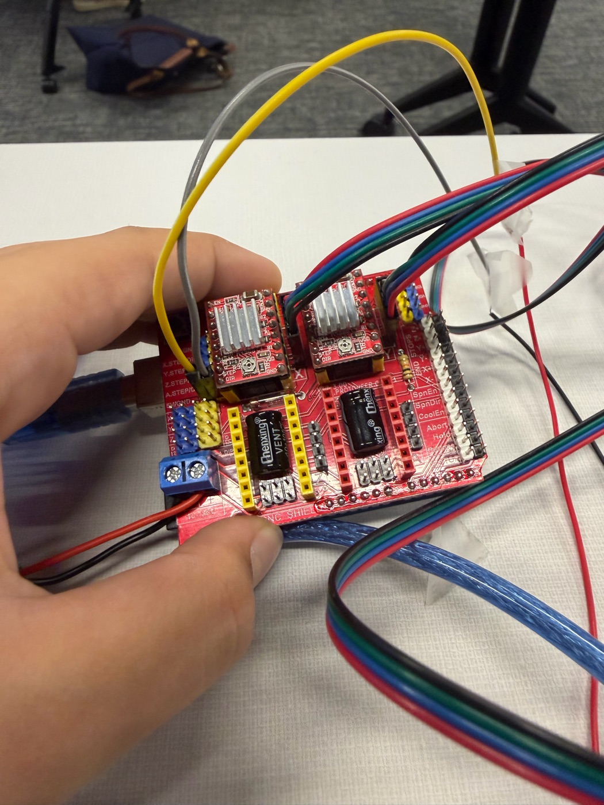
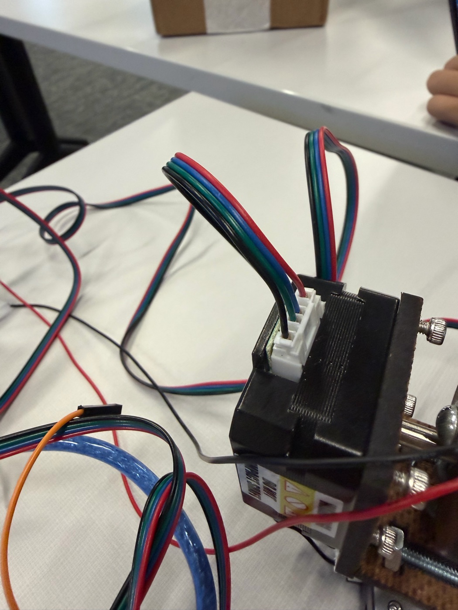
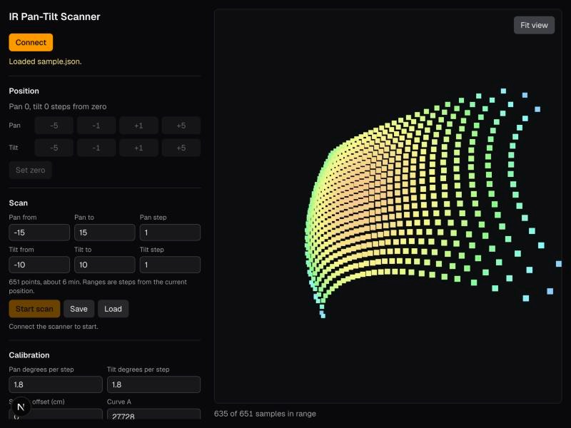
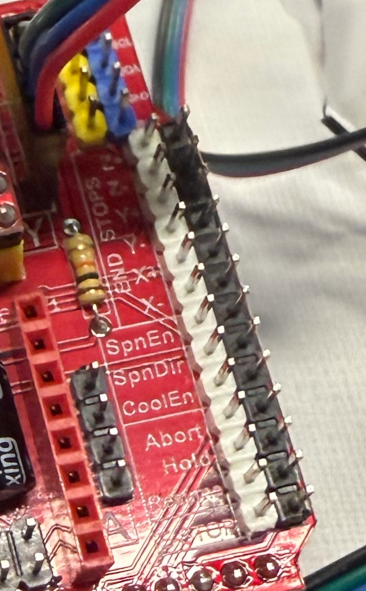

# 11-12-26 · 3D Scanner, Round Three: Turning Readings into a 3D Image

## Overview

In [Round Two](3d%20Scanner%2026-27.html) we got a stepper motor turning. This round the scanner has two stepper motors and an infrared (IR) distance sensor: one motor pans the base left and right, and the other tilts the sensor up and down through a screw linkage. The goal is software that sweeps the sensor across a grid of pan and tilt angles, takes a distance reading at each one, and pieces all of those points together into a 3D image you can rotate on the computer.

The software is built and tested, and the sensor is wired and working. The motors are where we're stuck: the Arduino accepts every move command, but the motors don't respond, and we're tracking down why (see [Problem 5](#problem-5-the-motors-dont-move)).

All of the code is in the [RLK repository on GitHub](https://github.com/kfidak13/RLK).

## Motivating questions

How do you turn a list of angles and distances into a 3D shape?

How does a web page control an Arduino, and how does it know the Arduino actually did what it was told?

The tilt axis can only travel so far before the linkage jams, and there are no limit switches. How do you keep software from driving it too far?

When nothing happens, how do you tell whether the problem is the code, the wiring, or the power?

## Materials

| Part | Details |
|---|---|
| Arduino Uno | Powered over USB from the laptop, which also powers the sensor |
| CNC Shield V3 | A Protoneer clone that plugs on top of the Uno |
| 2× A4988 stepper drivers | In the shield's X and Y slots, with heatsinks |
| 2× NEMA 17 stepper motors | 4-wire, 200 steps per turn (1.8° per step) |
| Sharp GP2Y0A21YK0F | IR distance sensor, about 10-80 cm range |
| 12V power supply | Into the shield's blue screw terminal; powers the motors only |
| Jumper wires, USB cable | |
| Laptop with Chrome or Edge | Needed for Web Serial, which Safari and Firefox don't support |

We didn't install any microstepping jumpers, so the drivers run in full-step mode at 200 steps per turn. There are no endstops (limit switches), which matters a lot for the tilt axis.





## How it works

There are three parts: the firmware on the Arduino, the web page on the laptop, and the math that turns readings into points.

### Part 1: The Arduino firmware

The Arduino doesn't run the scan itself. It waits for one-line text commands over USB and answers each one with one line, at 115200 baud:

| Command | What it does | Reply |
|---|---|---|
| `M <pan> <tilt>` | Move both motors by that many steps | `ok <pan> <tilt>` (position since startup) |
| `R` | Wait 100 ms for vibration to settle, take 10 readings 40 ms apart | `d <raw>` (the median) |
| `L <min> <max>` | Set how far tilt is allowed to go | `ok` |
| `A <0 or 1>` | Choose which driver is the tilt motor | `ok` |
| `Z` | Make the current position zero | `ok` |
| `E` / `D` | Enable or release the motors | `ok` |
| (at startup) | | `ready` |

Two safety rules live in the firmware, so a bug in the web page can't break the hardware:

- **Tilt limits.** Any move that would take tilt past its limit is refused with `err limit`, and neither motor moves. Limits start at ±20 steps until we measure the real travel.
- **Motors start released.** A move while the motors are released replies `err off` instead of silently doing nothing.

It uses the **median** of 10 readings instead of the average, because this sensor sometimes gives one wild reading, and a single spike would throw off an average.

### Part 2: The web page

The page is built with Next.js and draws the 3D view with three.js. It runs the whole scan one command at a time: move, read, save the reading, then the next point. The scan sweeps back and forth along pan and only ever moves tilt in one direction, so slack in the screw doesn't shift rows relative to each other. The default scan is 31 × 21 = 651 points and takes about 6 minutes.

The page saves the raw readings, not the finished points. That means if we fix a calibration number later, the 3D image updates without rescanning.



This is a made-up test scan of a sphere 40 cm away (`docs/sample-scan.json` in the repo), used to test the 3D view before the hardware was ready. It isn't a real scan yet.

### Part 3: The math

The sensor gives a voltage that gets smaller as things get farther away, and it isn't a straight line. To turn a raw reading (0-1023) into centimetres:

```
volts = raw × 5 / 1023
cm    = 27.728 × volts^(−1.2045)
```

Readings below 0.35 V, or outside 10-80 cm, are thrown out. Below about 10 cm this sensor's output drops again, so a very close object looks far away, and the software can't tell the difference.

Then each reading becomes a 3D point using the pan and tilt angles:

```
pan  = panSteps  × 1.8°
tilt = tiltSteps × (tilt degrees per step)
x = cm × cos(tilt) × sin(pan)
y = cm × sin(tilt)
z = cm × cos(tilt) × cos(pan)
```

We still have to measure the tilt degrees per step, because the tilt motor turns a screw instead of turning the sensor directly. Until it's measured, the Start button stays disabled.

## How to set it up yourself

1. **Wire it.** Pins are fixed by the CNC shield:

   | What | Arduino pin | On the shield |
   |---|---|---|
   | Enable both drivers | D8 (LOW = on) | Shared by all drivers |
   | X step / direction | D2 / D5 | X slot |
   | Y step / direction | D3 / D6 | Y slot |
   | Sensor signal | A3 | The **CoolEn** pin |
   | Sensor power | 5V / GND | The 5V/GND pins |

   Line up each driver's EN pin with the EN label on the shield. Never plug or unplug a motor while the 12V is on, because it can destroy the driver.

2. **Install the tools** (on a Mac, with [Homebrew](https://brew.sh)):

   ```bash
   brew install arduino-cli
   arduino-cli core install arduino:avr
   git clone https://github.com/kfidak13/RLK
   cd RLK
   npm --prefix web ci
   ```

3. **Flash the firmware.** Find the Uno's port with `arduino-cli board list`, then:

   ```bash
   arduino-cli compile --upload -p <port> --fqbn arduino:avr:uno firmware/scanner
   ```

4. **Start the page** with `npm --prefix web run dev`, open `http://localhost:3000` in Chrome or Edge, and press Connect.

5. **Follow the [hardware checklist](https://github.com/kfidak13/RLK/blob/main/docs/hardware-checklist.md)** to find which motor is which, measure the tilt limits and degrees per step, and calibrate against a flat wall.

## How I used AI

I used Claude (in Claude Code) as my coding partner. This was my first message about the software:

> ok, next step is creating a software that can piece together the data points the scanner gets to make a 3d image

What the AI did:

- Asked what I wanted to scan before designing anything. I picked a single object, from one side only.
- Wrote a design and a step-by-step plan for me to approve before writing any code.
- Wrote the firmware, the web page and 95 automated tests, plus a version of the firmware that runs on the laptop so the tilt limits could be tested without hardware.
- Tested the page against a **fake Arduino** that followed the same rules as the real one, including a cable being pulled out and the Arduino going silent mid-scan.
- Had a second AI review all of the code. It found two serious problems where tilt could go past its real limits, which were fixed before anything touched the hardware.
- Diagnosed the hardware problems below by sending the Arduino commands that couldn't move a motor and reading what came back.

What I did:

- Built and wired the scanner, and decided what the scanner should be able to do.
- Approved the design and plan before any code was written.
- Sent photos of the wiring when something wasn't working, and plugged things in, held objects in front of the sensor, and watched the motors during tests.

## Execution & troubleshooting

### Problem 1: The page wouldn't connect

The page waits for the Arduino to say `ready`, but it never came. The AI listened to the Arduino at both speeds without sending it anything. At 115200 baud there was only garbage, and at 9600 it said `Ready. Commands: x <steps>, y <steps>, r, s, o, f`. That's our old test sketch, so the new firmware had never been uploaded. Flashing it fixed the connection.

### Problem 2: A stray byte at startup

After flashing, the Arduino's first line sometimes came out with an extra junk byte stuck to the front: `\xf3ready` instead of `ready`. The page was looking for exactly `ready`, so it would have failed to connect. The fix was to accept any line that ends in `ready`, with tests for it.

### Problem 3: The sensor wire wasn't plugged in



The sensor's signal wire has to go to the CoolEn pin. In our photo, nothing was plugged into that header at all, and the signal wire was hanging loose. An unconnected pin still gives numbers (we saw readings around 400 that jumped around), so this kind of mistake doesn't cause an error. A scan would just come out as a cloud of junk points.

After plugging it in, we tested it with no motors moving:

| Setup | Raw reading | Voltage | Distance |
|---|---|---|---|
| Nothing in front | 38-49 | about 0.2 V | Out of range |
| Hand about 20 cm away | 360-386 | about 1.8 V | About 13-14 cm |

The reading jumped as soon as something was in front of it, so the sensor works. It said 14 cm when we were aiming for 20, so either the hand was closer than we thought or the curve needs adjusting. The flat-wall test will tell us.

### Problem 4: "Resource busy"

At one point the test couldn't even open the USB port. The Arduino IDE's Serial Monitor was still open, and only one program can use the port at a time. Closing it fixed it.

### Problem 5: The motors don't move

This is where we're stuck. The AI enabled the motors and moved each one 10 steps and back, and the Arduino answered `ok` to every command. But the motors made no sound, and the shafts stayed free to turn by hand the whole time.

That tells us a lot:

- **The code isn't the problem.** The Arduino received and accepted every command.
- **The motors never got any current.** An enabled stepper normally locks in place and is hard to turn by hand.
- **It's probably something the two motors share.** If one motor's wiring were wrong, the other would usually still move. Both being dead points at the 12V power or the shared enable pin (D8).

To check whether it was the firmware, we also tried two simple test sketches with no web page involved. One spins a motor nonstop, and this one moves both motors half a turn and back:

```cpp
void moveBoth(int direction) {
  digitalWrite(X_DIR_PIN, direction);
  digitalWrite(Y_DIR_PIN, direction);
  delayMicroseconds(2);
  for (int i = 0; i < STEPS; i++) {
    digitalWrite(X_STEP_PIN, HIGH);
    digitalWrite(Y_STEP_PIN, HIGH);
    delayMicroseconds(2);
    digitalWrite(X_STEP_PIN, LOW);
    digitalWrite(Y_STEP_PIN, LOW);
    delayMicroseconds(STEP_DELAY_US);
  }
  delay(PAUSE_MS);
}
```

What we're checking next, with the 12V off whenever we touch a wire:

- That the red and black wires are actually connected at the power supply end, red to + and black to −.
- That the screws in the blue terminal are clamping bare wire, not the plastic insulation.
- That the supply is on, says 12V, and can give about 2A.
- The voltage across the blue terminal with a multimeter. If it's about 12V, the next suspect is the enable pin.

## Links & references

**Datasheets and parts**

- http://localhost:3000/
- [Sharp GP2Y0A21YK0F datasheet](https://global.sharp/products/device/lineup/data/pdf/datasheet/gp2y0a21yk_e.pdf) and [Pololu's product page](https://www.pololu.com/product/136) for the IR sensor
- [Allegro A4988 datasheet](https://www.allegromicro.com/-/media/files/datasheets/a4988-datasheet.pdf) and [Pololu's A4988 driver page](https://www.pololu.com/product/1182), including setting the current limit
- [Protoneer Arduino CNC Shield](https://blog.protoneer.co.nz/arduino-cnc-shield/), the original shield our clone is based on
- [GRBL's wiring guide](https://github.com/gnea/grbl/wiki/Connecting-Grbl), which shows the shield's pin layout, including CoolEn on A3
- [Arduino Uno Rev3 documentation](https://docs.arduino.cc/hardware/uno-rev3/)
- [NEMA 17 stepper motors on the RepRap wiki](https://reprap.org/wiki/NEMA_17_Stepper_motor)

**Software**

- [arduino-cli documentation](https://arduino.github.io/arduino-cli/latest/)
- [Web Serial API on MDN](https://developer.mozilla.org/en-US/docs/Web/API/Web_Serial_API)
- [three.js documentation](https://threejs.org/docs/)
- [Next.js documentation](https://nextjs.org/docs)

**Our project**

- [RLK repository](https://github.com/kfidak13/RLK), with all of the code
- [The firmware](https://github.com/kfidak13/RLK/blob/main/firmware/scanner/scanner.ino) and [the web page](https://github.com/kfidak13/RLK/tree/main/web)
- [The design document](https://github.com/kfidak13/RLK/blob/main/docs/superpowers/specs/2026-11-02-3d-scan-viewer-design.md)
- [The hardware checklist](https://github.com/kfidak13/RLK/blob/main/docs/hardware-checklist.md)

## Personal Journey

### How did I feel?

The software side moved fast. Seeing the test scan show up as a 3D shape I could spin around made the whole idea of the scanner feel real for the first time.

### How feelings changed

The hardware was harder. Each fix uncovered the next problem: the old firmware, then the loose sensor wire, then the motors. The motors were the most frustrating, because I couldn't see anything wrong with the wiring. What helped was ruling things out one at a time. Knowing the code is fine and the sensor works narrowed it down to the power.

### What's next

1. **Get the motors moving** by checking the 12V power.
2. **Work through the hardware checklist:** find which motor is pan and which is tilt, measure the tilt limits, and calibrate against a flat wall.
3. **Take our first real scan** of an object 20-60 cm away.
