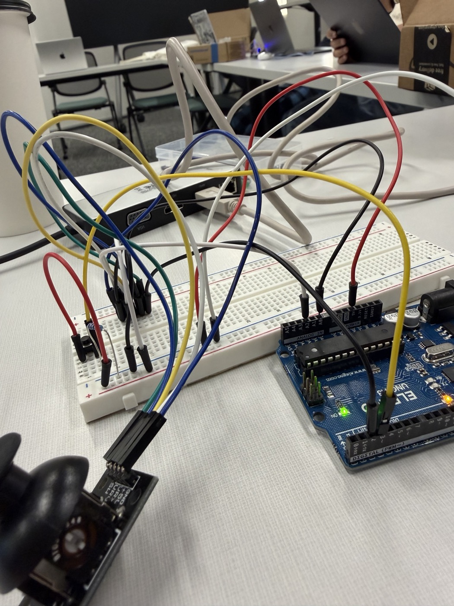
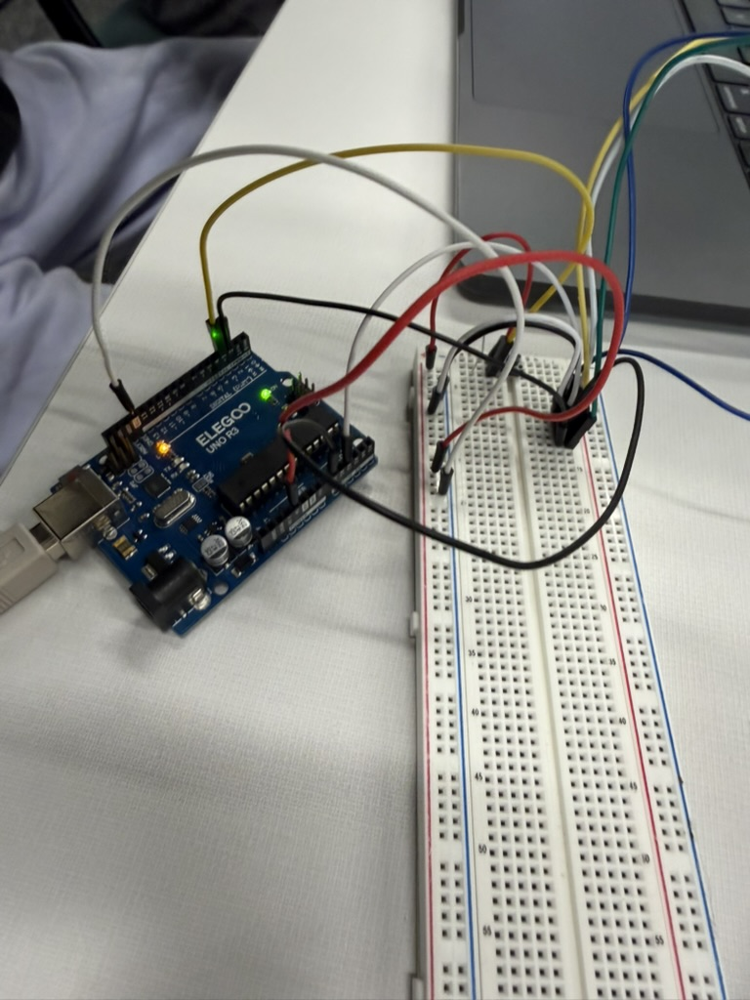

# 10-27-26 · Angry Piggies, Part Two: A Joystick Controller

## Overview

In [Part One](OneShotAutopsy.html) I took apart a one-shot AI game, rebuilt it, and grew it into Angry Piggies with 8 levels, scoring, stars, and a level select. This project is about controlling that game with something physical instead of a mouse: a joystick wired to an Arduino.

The goal: tilt the stick to pull the pig back on the slingshot, press it to fire, and press again mid-flight to dash.

## Motivating questions

How does an Arduino talk to a game running in a web browser?

How do you turn a joystick's tilt into something a game understands, like how far back the slingshot is pulled?

When the hardware doesn't work, how do you figure out if the problem is the wiring, the Arduino code, or the game code?

## Materials

Elegoo Uno R3 (an Arduino Uno)

Joystick module (the common 5-pin kind: GND, +5V, VRx, VRy, SW)

Push button and resistor

Breadboard and jumper wires

USB cable to the laptop

Chrome (it supports Web Serial, which Safari and Firefox don't)





## How it works

There are two halves: the Arduino code that reads the joystick, and the game code that listens to it.

### The Arduino side

A joystick is really two potentiometers (one for left and right, one for up and down) plus a button underneath. The Arduino reads each direction as a number from 0 to 1023 on an analog pin. The sketch turns that into a number from -100 to 100, where 0 is the center, and sends it over the USB cable about 50 times a second as a line of text like `-80,25,0` (x, y, and whether a button is pressed).

```cpp
void loop() {
  int x = readAxis(PIN_X, centerX, INVERT_X);
  int y = readAxis(PIN_Y, centerY, INVERT_Y);
  bool stickPressed = digitalRead(PIN_STICK_PRESS) == LOW;
  bool buttonPressed = digitalRead(PIN_BUTTON) == BUTTON_PRESSED;
  int pressed = stickPressed || buttonPressed ? 1 : 0;

  Serial.print(x);
  Serial.print(',');
  Serial.print(y);
  Serial.print(',');
  Serial.println(pressed);

  delay(20);
}
```

Two details make it feel right:

- **It measures the center when it starts.** Every joystick rests at a slightly different reading (not exactly 512), so the sketch reads where the stick sits at power-up and treats that as zero.
- **It has a deadzone.** Readings within 40 of the center count as "not touched," so the pig doesn't drift when you aren't holding the stick.

### The game side

The game uses the Web Serial API, which lets a web page read from a USB device after you click a button and pick the port. I added a **🕹 Connect joystick** button next to the Levels button. Once connected, the game reads each line and splits it into the three numbers:

```js
function onJoystickLine(line) {
  const [x, y, button] = line.trim().split(',').map(Number);
  if ([x, y, button].some(Number.isNaN)) return; // half a line right after connecting
  joystick.x = x / 100;
  joystick.y = y / 100;
  const pressed = button === 1;
  if (pressed && !joystick.pressed) onJoystickPress();
  joystick.pressed = pressed;
}
```

The stick's tilt becomes the slingshot pull, so tilting all the way is the same as dragging the pig back the full 160 pixels with the mouse. The dotted aim line shows up while you aim. Pressing the button fires. Pressing it again while the pig is flying uses the dash. On the win or lose card, pressing it does the same thing as the main button (Next level or Retry).

The button only reacts the moment it goes from not pressed to pressed. Without that, holding the button down for a split second would fire and then instantly dash on the same press.

## How I used AI

I used Claude (in Claude Code) as my coding partner for this. This was my first message to it:

> Now i need to connect a joystick to the game using arduino ide, i have the setup for the arduino, but now i need the code for the joystick to work, and to connnect it to the game, what do i do

What the AI did:

- Wrote the Arduino sketch and compiled it for the Uno to make sure it had no errors.
- Picked Web Serial as the way to connect, since it's built into Chrome and doesn't need any extra program running on the laptop.
- Added the joystick controls to the game.
- Tested the game side with a **fake joystick**. The AI didn't have my Arduino, so it made a test page that pretended to be a serial port and fed the game the same kind of lines the Arduino sends. That let it check that tilting aims, the button fires and dashes, and Retry works, all before I plugged anything in.
- Wrote step-by-step setup instructions: wiring, uploading, checking the numbers in the Serial Monitor, and connecting in Chrome.

What I did:

- Built the circuit and told the AI where my wires actually went.
- When the AI asked me to clarify which pins the joystick used, I sent it a photo of my wiring instead.
- Decided not to save (commit) the code until I'd tried it on my real Arduino.

For me, AI's biggest role was helping me code. I knew how the joystick needed to be wired and what the game needed from it, so I had the AI write out the Arduino sketch and the Web Serial code in the game while I focused on the physical side: building the circuit, plugging the wires into the board, and testing. That split let both halves move at the same time instead of one after the other.

The AI still needed me for anything it couldn't see. It didn't know how my board was wired, so its first version used the default pins instead of the ones I had set up, and I had to tell it where everything actually was. Working on hardware made that split really clear: the AI could write the code, but only I knew what was actually on my desk.

## Execution & troubleshooting

### Problem 1: The pins didn't match

The AI's first version assumed the most common wiring: the two directions on A0 and A1, and the joystick's button on pin 2. My circuit was different, so I told it the button was in pin 3 and the stick was in pin 2.

The AI wasn't sure what I meant by the stick being in pin 2. A joystick's directions are analog signals that only work on the analog pins (A0 to A5), and pin 2 is a digital pin, so it asked me to clarify. Instead of explaining wire by wire, I sent it a photo of the board so it could see the whole setup at once:

| Wire | Pin | What it is |
|---|---|---|
| Black | A0 | One stick direction |
| White | A2 | The other stick direction |
| Red | 5V | Power for the joystick |
| Black | Pin 2 | The joystick's own press (SW) |
| Yellow | Pin 3 | The separate push button on the breadboard |

Pin 2 is the joystick's click and pin 3 is the extra push button, just like I said. The fix was changing the pin numbers in the sketch to match my wiring and making both buttons count as fire.

### Problem 2: Two buttons wired two different ways

The two buttons need different settings:

- **The joystick's button** has no resistor of its own. It connects the pin to ground when pressed, so the sketch turns on the Arduino's built-in pull-up resistor (`INPUT_PULLUP`), and pressed reads as `LOW`.
- **The breadboard push button** has its own resistor. With the button going to 5V and the resistor going to ground (a pull-down), pressed reads as `HIGH`. If the resistor goes to 5V instead, it's the other way around.

The AI couldn't tell from the photo which way my resistor went, so it added a setting for it in the sketch, `BUTTON_PRESSED`. If the Serial Monitor shows the button stuck at 1 when nothing is pressed, that setting gets flipped to `LOW`.

### Problem 3: Is everything grounded?

The AI pointed out that in the first photo there's a red wire from 5V to the breadboard, but no ground wire from the Arduino is visible. Without a shared ground, the joystick's readings and the buttons float and give random numbers. My ground wire was connected, just out of the frame, which is part of why everything worked on the first try.

### My checklist for testing on the real board

- A ground wire runs from an Arduino GND pin to the breadboard's minus rail.
- In the Serial Monitor (115200 baud), pushing the stick right makes the first number go positive and pushing it toward me makes the second number go positive. If one is backwards, flip `INVERT_X` or `INVERT_Y`. If right changes the second number instead, swap `PIN_X` and `PIN_Y`.
- The third number is 0 at rest and 1 when either button is pressed.
- The Serial Monitor is closed before connecting the game. Only one program can use the USB port at a time, so if it's open, Chrome's port picker can't connect.

### Testing on the real board

The hardware was easy to figure out. Once the pins in the sketch matched where our wires actually were, we uploaded it, and the joystick was working almost immediately. We didn't have to rewire anything or go back and forth guessing whether the problem was the circuit or the code.

Because the Arduino side worked right away, getting the game working was fast as well. We connected the joystick in Chrome, and the pig responded to the stick. Most of the troubleshooting had already happened before we plugged anything in, when we got the code to match my wiring, so by the time we tested on the real board, there wasn't much left to fix.


## Personal Journey

### How did I feel?

I felt it was fairly easy to get this working, mostly because of the work I'd already done on the previous game. In Part One, I went through the Angry Piggies code piece by piece, so I already knew how the slingshot, the aiming, and the launch worked. When it came time to connect a joystick, I wasn't learning a brand new program. I was adding a new way to control something I already understood, and that made the whole project go smoothly.

### How feelings changed

Not too much changed. I started out feeling like this would be manageable, and that's how it went. The only real bump was getting the AI's code to match my wiring, and once it had the photo, everything else fell into place quickly. If anything, getting the joystick working so fast made me more confident about mixing hardware and code in future projects, since understanding the code first made the hardware part go a lot smoother.

### What's next

1. **Save the code** to the [AngryPigsCode repo](https://github.com/kfidak13/AngryPigsCode) now that it works (the sketch will be in `arduino/joystick/joystick.ino`).
2. **Update the playable game on this site** with joystick support, so anyone with the same setup can connect from this page.
