# 10-12-26 · One Shot Autopsy: Angry Piggies

## The Game

In class, we were given the goal to one-shot vibe code a game. I was immediately skeptical of the capabilities of AI being able to do that, as I am familiar with AI coding and I know that it takes a ton of planning for an AI to get it right. So, I gave it this prompt:

> Alright I need a game like angry birds, where you have a catapult and you launch something. Instead I want to throw a twist on it, I want it to be the piggies going at the birds instead of the other way around. I need this to be a one shot. I need simple features, simple slingshot that launches a round pig and a structure that has breaking physics. The structure will have the birds on it and the goal is to get them to fall, don't go to complicated keep it simple and focus on core game mechanics.

Looking back on it, I could have phrased it better for the AI to understand what I was saying, but we were just doing a quick one-shot, so not too much detail was included in the prompt.

## The Return

The AI came back with a single HTML file it called "Angry Piggies." It used Matter.js, a JavaScript physics library, to handle the slingshot, the tower, and the collisions. You get three pigs to launch at a two-level wooden tower with four birds on it, plus a small scoreboard and a win or game over message at the end.


[Play the game yourself](games/angry-piggies.html) (drag the pig back and let go to launch it).

<details markdown="1">
<summary>View the full code the AI returned</summary>

```html
<!DOCTYPE html>
<html lang="en">
<head>
<meta charset="UTF-8">
<meta name="viewport" content="width=device-width, initial-scale=1.0">
<title>Angry Piggies</title>
<style>
  html, body { margin: 0; padding: 0; overflow: hidden; background: #87CEEB; font-family: Arial, Helvetica, sans-serif; }
  #hud {
    position: absolute; top: 10px; left: 10px; color: #fff;
    font-size: 20px; font-weight: bold; text-shadow: 1px 1px 2px rgba(0,0,0,0.6);
    user-select: none; pointer-events: none;
  }
  #message {
    position: absolute; top: 40%; width: 100%; text-align: center;
    font-size: 48px; font-weight: bold; color: #fff;
    text-shadow: 2px 2px 4px rgba(0,0,0,0.7); display: none;
    user-select: none; pointer-events: none;
  }
</style>
</head>
<body>
<div id="hud"></div>
<div id="message"></div>
<script src="https://cdn.jsdelivr.net/npm/matter-js@0.19.0/build/matter.min.js"></script>
<script>
(function () {
  'use strict';

  const { Engine, Render, Runner, Bodies, Body, Composite, Constraint, Mouse, MouseConstraint, Events, Vector } = Matter;

  const WIDTH = window.innerWidth;
  const HEIGHT = window.innerHeight;
  const GROUND_Y = HEIGHT - 40;
  const SLING_X = 180;
  const SLING_Y = GROUND_Y - 140;
  const TOTAL_PIGS = 3;

  const engine = Engine.create();
  const world = engine.world;

  const render = Render.create({
    element: document.body,
    engine: engine,
    options: {
      width: WIDTH,
      height: HEIGHT,
      wireframes: false,
      background: '#87CEEB'
    }
  });
  Render.run(render);
  Runner.run(Runner.create(), engine);

  // --- Static scenery ---
  const ground = Bodies.rectangle(WIDTH / 2, GROUND_Y + 20, WIDTH * 2, 80, {
    isStatic: true,
    label: 'ground',
    render: { fillStyle: '#5da130' }
  });

  const slingPole = Bodies.rectangle(SLING_X, SLING_Y + 70, 14, 140, {
    isStatic: true,
    isSensor: true,
    render: { fillStyle: '#6b4226' }
  });

  Composite.add(world, [ground, slingPole]);

  // --- Pig (projectile) ---
  let pig = null;
  let sling = null;
  let pigsLeft = TOTAL_PIGS;
  let launched = false;

  function createPig() {
    pig = Bodies.circle(SLING_X, SLING_Y, 22, {
      label: 'pig',
      density: 0.006,
      restitution: 0.4,
      friction: 0.6,
      render: { fillStyle: '#7ec850', strokeStyle: '#4e8a2e', lineWidth: 3 }
    });
    sling = Constraint.create({
      pointA: { x: SLING_X, y: SLING_Y },
      bodyB: pig,
      stiffness: 0.05,
      damping: 0.02,
      length: 1,
      render: { strokeStyle: '#6b4226', lineWidth: 4 }
    });
    launched = false;
    Composite.add(world, [pig, sling]);
  }

  // --- Structure with breaking physics ---
  const blocks = [];
  function addBlock(x, y, w, h) {
    const block = Bodies.rectangle(x, y, w, h, {
      label: 'block',
      density: 0.002,
      friction: 0.8,
      restitution: 0.1,
      render: { fillStyle: '#c9933a', strokeStyle: '#8a5a1b', lineWidth: 2 }
    });
    block.hitPoints = 2;
    blocks.push(block);
    Composite.add(world, block);
    return block;
  }

  // --- Birds (targets) ---
  const birds = [];
  const birdColors = ['#d93025', '#f6b73c', '#4a90d9'];
  function addBird(x, y, colorIndex) {
    const bird = Bodies.circle(x, y, 16, {
      label: 'bird',
      density: 0.001,
      restitution: 0.3,
      friction: 0.5,
      render: { fillStyle: birdColors[colorIndex % birdColors.length], strokeStyle: '#7a1510', lineWidth: 3 }
    });
    bird.alive = true;
    birds.push(bird);
    Composite.add(world, bird);
    return bird;
  }

  function buildLevel() {
    const bx = WIDTH - 320;

    // Two towers with a bridge
    addBlock(bx - 80, GROUND_Y - 60, 20, 120);   // left pillar
    addBlock(bx + 80, GROUND_Y - 60, 20, 120);   // right pillar
    addBlock(bx, GROUND_Y - 130, 220, 20);       // bridge

    addBlock(bx - 50, GROUND_Y - 190, 20, 100);  // upper left pillar
    addBlock(bx + 50, GROUND_Y - 190, 20, 100);  // upper right pillar
    addBlock(bx, GROUND_Y - 250, 160, 20);       // roof

    addBird(bx - 80, GROUND_Y - 30, 0);          // ground bird (inside)
    addBird(bx + 80, GROUND_Y - 30, 0);
    addBird(bx, GROUND_Y - 160, 1);              // bridge bird
    addBird(bx, GROUND_Y - 280, 2);              // roof bird
  }

  buildLevel();
  createPig();

  // --- Mouse / slingshot control ---
  const mouse = Mouse.create(render.canvas);
  const mouseConstraint = MouseConstraint.create(engine, {
    mouse: mouse,
    constraint: { stiffness: 0.1, render: { visible: false } }
  });
  render.mouse = mouse;
  Composite.add(world, mouseConstraint);

  // Only allow dragging the current pig
  Events.on(mouseConstraint, 'startdrag', (e) => {
    if (e.body !== pig || launched) {
      mouseConstraint.constraint.bodyB = null;
    }
  });

  Events.on(mouseConstraint, 'enddrag', (e) => {
    if (e.body === pig && !launched) {
      const pull = Vector.magnitude(Vector.sub(pig.position, { x: SLING_X, y: SLING_Y }));
      if (pull > 15) {
        launched = true;
        pigsLeft--;
        // Release from sling shortly after so the elastic snaps the pig forward
        setTimeout(() => {
          sling.bodyB = null;
          Composite.remove(world, sling);
          scheduleNextPig();
        }, 60);
      }
    }
  });

  function scheduleNextPig() {
    setTimeout(() => {
      if (gameOver) return;
      if (pig) Composite.remove(world, pig);
      if (pigsLeft > 0) {
        createPig();
      } else {
        checkLose();
      }
    }, 3500);
  }

  // --- Collisions: break blocks, knock out birds ---
  Events.on(engine, 'collisionStart', (event) => {
    for (const pair of event.pairs) {
      const { bodyA, bodyB } = pair;

      // Block damage from hard impacts
      for (const [body, other] of [[bodyA, bodyB], [bodyB, bodyA]]) {
        if (body.label === 'block') {
          const impact = Vector.magnitude(Vector.sub(body.velocity, other.velocity)) * other.mass;
          if (impact > 25) {
            body.hitPoints--;
            body.render.fillStyle = body.hitPoints === 1 ? '#a8742a' : body.render.fillStyle;
            if (body.hitPoints <= 0) {
              Composite.remove(world, body);
            }
          }
        }
      }

      // Bird knocked out by pig hit or by falling to the ground
      for (const [body, other] of [[bodyA, bodyB], [bodyB, bodyA]]) {
        if (body.label === 'bird' && body.alive) {
          const hitByPig = other.label === 'pig';
          const hitGround = other.label === 'ground' && Vector.magnitude(body.velocity) > 3;
          if (hitByPig || hitGround) {
            knockOutBird(body);
          }
        }
      }
    }
  });

  function knockOutBird(bird) {
    bird.alive = false;
    bird.render.fillStyle = '#999';
    bird.render.strokeStyle = '#666';
    setTimeout(() => Composite.remove(world, bird), 1200);
    checkWin();
  }

  // --- Win / lose ---
  let gameOver = false;
  const messageEl = document.getElementById('message');
  const hudEl = document.getElementById('hud');

  function checkWin() {
    if (birds.every((b) => !b.alive)) {
      gameOver = true;
      messageEl.textContent = 'YOU WIN!';
      messageEl.style.display = 'block';
    }
  }

  function checkLose() {
    if (!gameOver && pigsLeft <= 0) {
      setTimeout(() => {
        if (!gameOver) {
          gameOver = true;
          messageEl.textContent = 'GAME OVER';
          messageEl.style.display = 'block';
        }
      }, 2000);
    }
  }

  // --- HUD + custom drawing (pig/bird faces, trajectory dots) ---
  const trail = [];

  Events.on(render, 'afterRender', () => {
    const ctx = render.context;
    const remaining = birds.filter((b) => b.alive).length;
    hudEl.textContent = `Pigs: ${pigsLeft}${!launched && pig ? ' (loaded)' : ''}  |  Birds left: ${remaining}`;

    // Trajectory trail
    if (pig && launched) {
      trail.push({ x: pig.position.x, y: pig.position.y });
      if (trail.length > 40) trail.shift();
    } else if (!launched) {
      trail.length = 0;
    }
    ctx.fillStyle = 'rgba(255,255,255,0.6)';
    for (let i = 0; i < trail.length; i += 3) {
      ctx.beginPath();
      ctx.arc(trail[i].x, trail[i].y, 3, 0, Math.PI * 2);
      ctx.fill();
    }

    // Pig face
    if (pig) drawPigFace(ctx, pig);

    // Bird faces
    for (const bird of birds) {
      if (Composite.get(world, bird.id, 'body')) drawBirdFace(ctx, bird);
    }
  });

  function drawPigFace(ctx, body) {
    const { x, y } = body.position;
    // Snout
    ctx.fillStyle = '#5ea33b';
    ctx.beginPath();
    ctx.ellipse(x, y + 2, 9, 7, 0, 0, Math.PI * 2);
    ctx.fill();
    ctx.fillStyle = '#3c6e24';
    ctx.beginPath();
    ctx.arc(x - 3, y + 2, 1.5, 0, Math.PI * 2);
    ctx.arc(x + 3, y + 2, 1.5, 0, Math.PI * 2);
    ctx.fill();
    // Eyes
    ctx.fillStyle = '#fff';
    ctx.beginPath();
    ctx.arc(x - 8, y - 8, 4, 0, Math.PI * 2);
    ctx.arc(x + 8, y - 8, 4, 0, Math.PI * 2);
    ctx.fill();
    ctx.fillStyle = '#000';
    ctx.beginPath();
    ctx.arc(x - 7, y - 8, 1.8, 0, Math.PI * 2);
    ctx.arc(x + 9, y - 8, 1.8, 0, Math.PI * 2);
    ctx.fill();
  }

  function drawBirdFace(ctx, body) {
    const { x, y } = body.position;
    // Eyes
    ctx.fillStyle = '#fff';
    ctx.beginPath();
    ctx.arc(x - 5, y - 4, 3.5, 0, Math.PI * 2);
    ctx.arc(x + 5, y - 4, 3.5, 0, Math.PI * 2);
    ctx.fill();
    ctx.fillStyle = '#000';
    ctx.beginPath();
    if (body.alive) {
      ctx.arc(x - 4, y - 4, 1.5, 0, Math.PI * 2);
      ctx.arc(x + 6, y - 4, 1.5, 0, Math.PI * 2);
      ctx.fill();
    } else {
      // X eyes
      ctx.strokeStyle = '#000';
      ctx.lineWidth = 1.5;
      for (const ex of [x - 5, x + 5]) {
        ctx.beginPath();
        ctx.moveTo(ex - 2, y - 6); ctx.lineTo(ex + 2, y - 2);
        ctx.moveTo(ex + 2, y - 6); ctx.lineTo(ex - 2, y - 2);
        ctx.stroke();
      }
    }
    // Beak
    ctx.fillStyle = '#f5a623';
    ctx.beginPath();
    ctx.moveTo(x - 4, y + 3);
    ctx.lineTo(x + 8, y + 5);
    ctx.lineTo(x - 4, y + 8);
    ctx.closePath();
    ctx.fill();
  }
})();
</script>
</body>
</html>
```

</details>

## Autopsy: How the Code Works

To actually understand what the AI built, I went through the code piece by piece. The whole game is about 300 lines in one HTML file, and most of the heavy lifting is done by Matter.js, a physics library the AI pulled in instead of writing its own physics.

### The canvas

There is no `<canvas>` tag anywhere in the HTML. Matter.js creates one for you when this runs:

```js
const render = Render.create({
  element: document.body,
  engine: engine,
  options: { width: WIDTH, height: HEIGHT, wireframes: false, background: '#87CEEB' }
});
```

`WIDTH` and `HEIGHT` are set to `window.innerWidth` and `window.innerHeight`, so the canvas fills whatever size the browser window is when the page loads. On a 1280 by 720 window, the canvas is exactly 1280 by 720.

Everything else is placed relative to those two numbers. The ground sits at `GROUND_Y = HEIGHT - 40` and the tower is built at `WIDTH - 320`. So if you change the width, the tower moves with it: a narrower window puts the tower closer to the slingshot, which makes the game easier. Changing the height moves the ground and the slingshot up or down. One catch is that these values are only read once, so if you resize the window after the game loads, the canvas does not resize with it.

### The state variables

These are the values the game keeps track of. Most are declared near the top of the script with `let` or `const`, except `gameOver`, which is declared further down right above the win and lose functions:

| Variable | What it tracks |
|---|---|
| `pig`, `sling` | The pig currently loaded and the elastic holding it |
| `pigsLeft` | Pigs remaining, starts at `TOTAL_PIGS` (3) |
| `launched` | Whether the current pig has been fired yet |
| `blocks`, `birds` | Lists of every block and bird in the level |
| `block.hitPoints` | Each block starts with 2 hits before it breaks |
| `bird.alive` | Whether each bird has been knocked out |
| `gameOver` | Set to `true` on a win or a loss |

Position and speed are not variables the game declares itself. Matter.js stores them on every physics body as `body.position` and `body.velocity`, and the game just reads them when it needs them.

### The game loop

There is no `requestAnimationFrame` or `setInterval` written in the game code. Instead these two lines start the loop:

```js
Render.run(render);
Runner.run(Runner.create(), engine);
```

Both of these use `requestAnimationFrame` inside Matter.js, so the loop runs about 60 times a second. Each time it runs, it does two things:

1. **Update:** the Runner steps the physics engine forward, moving every body and checking for collisions.
2. **Draw:** the Renderer redraws every body, then fires an `afterRender` event, which is where the game draws its own extras: the HUD text, the trail of dots behind the pig, and the pig and bird faces.

### Input handling

There are no keyboard controls at all. The game is played entirely with the mouse: you click and drag the pig back, then let go. That is handled by a Matter.js `MouseConstraint` and two event listeners:

- `startdrag` cancels the drag if you grab anything that isn't the loaded pig.
- `enddrag` is the launch. It measures how far the pig was pulled from the slingshot, and if it's more than 15 pixels, it fires:

```js
if (pull > 15) {
  launched = true;
  pigsLeft--;
  setTimeout(() => {
    sling.bodyB = null;
    Composite.remove(world, sling);
    scheduleNextPig();
  }, 60);
}
```

So letting go changes three things: `launched` becomes `true`, `pigsLeft` goes down by one, and 60 milliseconds later the elastic is removed so the pig flies free. Then `scheduleNextPig()` waits 3.5 seconds and loads the next pig, or checks for a loss if you're out.

### Collision and win/lose logic

Matter.js detects the collisions, and the game listens for them with `Events.on(engine, 'collisionStart', ...)`. For blocks, it calculates how hard the hit was:

```js
const impact = Vector.magnitude(Vector.sub(body.velocity, other.velocity)) * other.mass;
if (impact > 25) {
  body.hitPoints--;
```

When a block's `hitPoints` reaches 0, it gets removed. Birds are knocked out if the pig touches them (`other.label === 'pig'`) or if they hit the ground faster than a speed of 3.

The game is won when `birds.every((b) => !b.alive)` is true, meaning no bird is still alive. It's lost when `pigsLeft <= 0` and you haven't already won, after a 2 second delay.

### Scoring

There isn't a real score. The closest thing is the HUD at the top left, which shows `Pigs: 3 | Birds left: 4`. It's redrawn every frame from two values: `pigsLeft`, which only changes on the `pigsLeft--` line in the launch code, and the birds left count, which is calculated fresh each frame with `birds.filter((b) => b.alive).length`.

## What I Noticed

The game really struggled with physics. It had a good-looking GUI, but the slingshot mechanics and the breaking of the tower never worked the way they should.

When you pull the pig back and let go, it barely moves. It just drops and flops onto the slingshot post. After three pigs like that, it's game over with all four birds still standing.

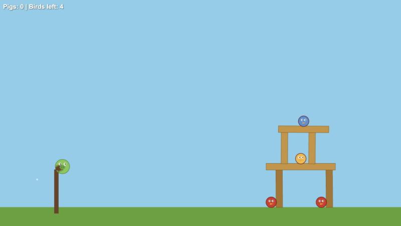

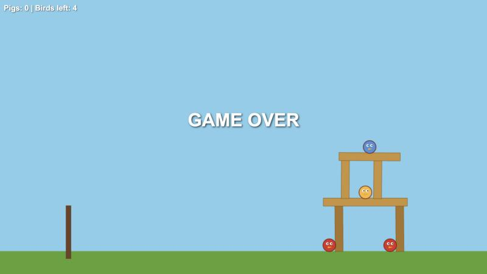

Going through the code explained a lot of this:

- **The slingshot only pulls for 60 milliseconds.** The elastic is very loose (`stiffness: 0.05`) and gets removed 60 ms after you let go, so it never has time to actually fling the pig.
- **The ground has infinite mass.** In Matter.js, anything that's static (like the ground) has a mass of `Infinity`. So in the impact formula, any block touching the ground with even the tiniest movement gets an impact of `Infinity`, which is always more than 25. On top of that, the bottom pillars are placed so they start 20 pixels inside the ground, so the physics engine pushes them up the second the game starts. That's why the bottom pillars are already darkened in the very first screenshot, before a single pig has been launched.

That lined up with what I expected going in. AI isn't at the point yet where it can take one prompt and build a whole working game from it. To get something like this right, it either needs a lot of context and clear limits to keep it focused on what you actually want, or it needs real planning done ahead of time, before any code gets written. A one-shot skips both of those, so you end up with something that looks finished on the surface but falls apart once you actually play it.

## Goals for This Week

1. **Plan before I prompt.** Before going back to the AI, I'll write a short plan for Angry Piggies: the exact mechanics (how far you can pull, how strong the launch is, how many hits a block can take), and what "working" means for each one. Then I'll give the AI that plan instead of a one-line idea, and compare the result to this one-shot. That tests the main thing I took away from this: more context and planning should mean a better game.
2. **Fix the two physics bugs I found myself.** I'll change the impact check so it ignores static bodies like the ground, and move the bottom pillars so they don't start inside the ground. I'll know it worked when the pillars are no longer damaged at the start and the tower only breaks when a pig actually hits it.
3. **Make the slingshot actually launch.** I'll experiment with the elastic's `stiffness` and how long it stays attached, or give the pig a launch speed based on how far it was pulled back. The goal is a pig that reaches the tower on a full pull.
4. **Add a real score and a restart key.** Since the game has no score and no keyboard controls, I'll add a `score` variable that goes up for each bird knocked out and each block broken, plus a key listener so pressing R restarts the level. This gives me practice with the two parts of the autopsy the AI skipped.

## Round Two: The New Version

After the autopsy, I made a second version of Angry Piggies using Devin, an AI coding agent. This time, instead of a one-shot, we planned it out first, then had the AI build from that plan. The code lives in its own repo, [AngryPigsCode](https://github.com/kfidak13/AngryPigsCode), and the changes line up directly with the bugs I found in the first version.

[Play the new version](games/angry-piggies-v2/index.html) and compare it to [the original one-shot](games/angry-piggies.html).


### What changed

| | One-shot version | New version |
|---|---|---|
| **Files** | One HTML file, about 350 lines | Split into `index.html`, `style.css`, and `game.js`, about 1,200 lines |
| **Slingshot** | Loose elastic (`stiffness: 0.05`) cut after 60 ms, so the pig flopped onto the post | Stiffer elastic (`0.10`) that lets go the moment the pig passes back through the slingshot, with the pull capped at 160 px |
| **Aiming** | No preview | A dotted line shows where the pig will fly before you let go |
| **Ground damage** | The ground's infinite mass counted as a huge hit, so blocks started damaged | Static objects use the block's own mass instead, and nothing can take damage during the first second while the tower settles |
| **Pillars** | Started 20 px inside the ground | The ground was moved down so the pillars sit right on top of it |
| **Birds** | Only knocked out by touching the pig or hitting the ground fast | Knocked out by any real impact, like a falling block |
| **Next pig** | Loaded on a fixed 3.5 second timer | Loads once the pig stops moving, leaves the screen, or after 7 seconds |
| **Visuals** | Plain shapes on a blue background | Custom drawing: sky, sun, moving clouds, hills, wood and stone blocks that crack, dust and star effects, icon HUD, and win and lose cards |

### How the fixes work

The ground damage fix is one line. Instead of always multiplying by the other object's mass, it checks if that object is static first:

```js
const m = other.isStatic ? body.mass : other.mass;
const impact = relSpeed * m;
```

So a block resting on the ground only gets hurt by its own weight moving fast, not by the ground's infinite mass.

The slingshot fix replaces the 60 ms timer with a check that runs every frame. It lets go of the pig right when it crosses back through the sling point, which is the moment it's moving fastest:

```js
if (Vector.dot(travel, releaseDir) <= 0 || now - releaseAt > ELASTIC_DETACH_MS) {
  detachSling();
}
```

The new version also pulls all the important numbers into a "Tuning" section at the top of `game.js` (like `PULL_LIMIT`, `ELASTIC_STIFFNESS`, and `BLOCK_BREAK_IMPACT`), so changing how the game feels means editing one number instead of hunting through the code.

### How it plays

This time, pulling back actually launches the pig. The dotted aim line shows the arc, the pig flies all the way to the tower, and the hit cracks the stone, knocks the pillars loose, and brings the whole tower down.

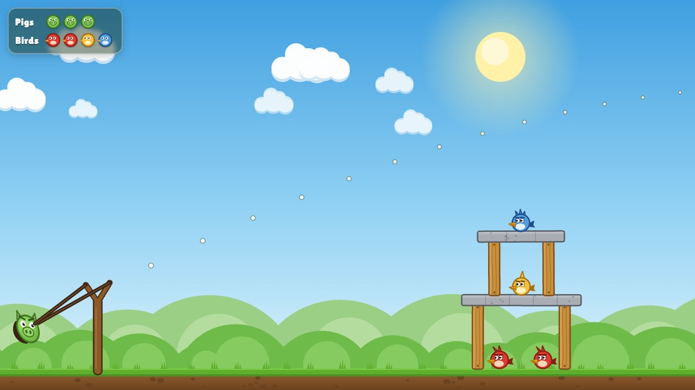

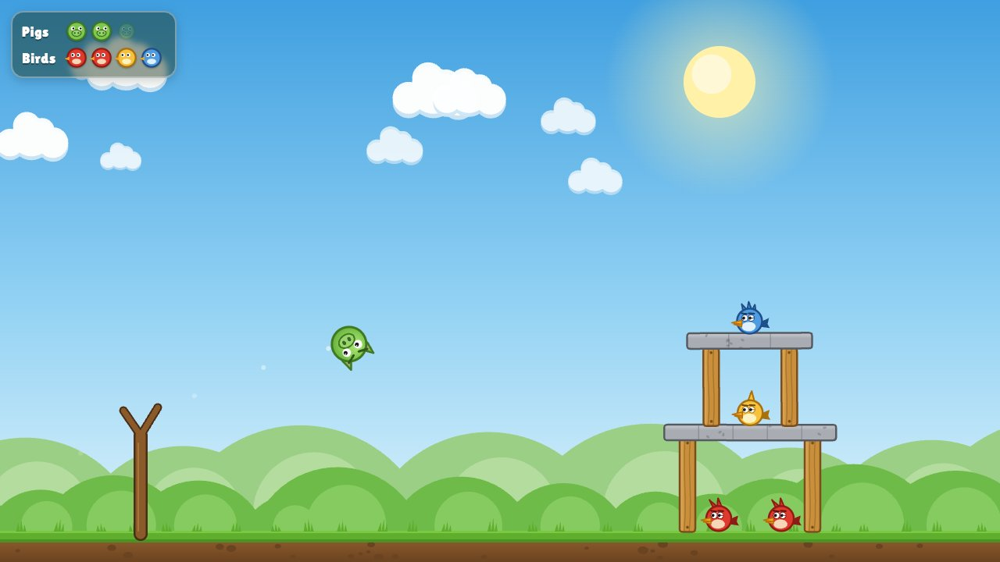

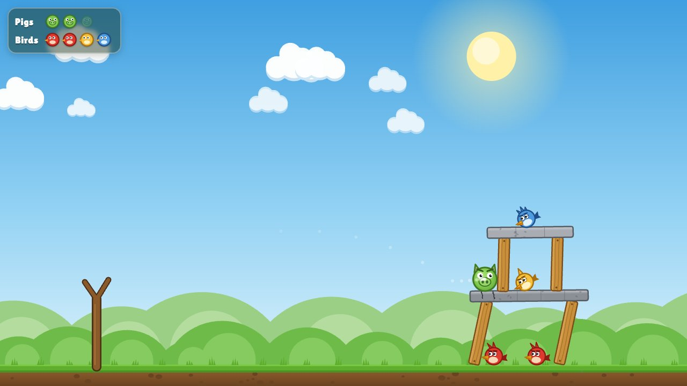

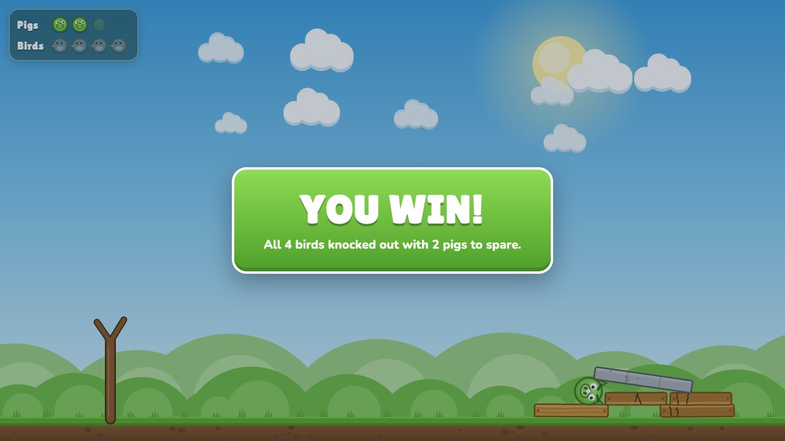

In my test, one full pull knocked out all four birds with two pigs to spare. That's a huge jump from the one-shot, where none of the three pigs even reached the tower, but it also means the game is now too easy. Winning with your first pig shouldn't be possible.

### Checking my goals

- **Plan before I prompt:** done. We planned the new version out before handing it to the AI, and the result is night and day compared to the one-shot.
- **Fix the two physics bugs:** done. The pillars start undamaged and sit on the ground properly.
- **Make the slingshot actually launch:** done. A full pull now reaches the tower and knocks it down.
- **Add a real score and a restart key:** not yet. There's still no score, and the lose card says to refresh the page to try again. This is still on my list.

Comparing the two versions backs up what I noticed the first time. The one-shot looked fine but didn't work. With a plan, the new version goes after the exact problems the autopsy found, and it even organizes the code better. That's the difference between asking for a whole game in one prompt and planning it out first.

### Next steps

1. **Make it harder.** Now that the physics works, one pig is enough to win, so the challenge is gone. I'll use the Tuning section to make blocks tougher (`BLOCK_BREAK_IMPACT`) and lower the pull limit (`PULL_LIMIT`), and try a stronger tower design. The goal is a level that takes at least two good shots to beat.
2. **Add a score and a restart key.** Carried over from this week: a score for every bird and block, and pressing R to restart instead of refreshing.


## Round Three: 8 New Levels

The next step after Round Two was making the game harder, so I added 8 new levels. Each one is tougher than the last, and you have to clear a level to unlock the next one.

**[Play all 8 levels](games/angry-piggies-v2/index.html)** (the code is in the [AngryPigsCode repo](https://github.com/kfidak13/AngryPigsCode)). Click any level below to jump straight to it.

<div class="level-grid">
  <a href="games/angry-piggies-v2/index.html#1">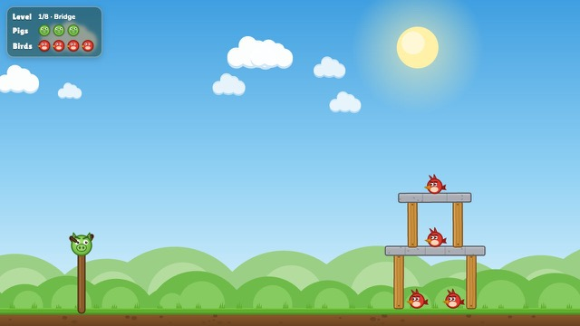<span>1. Bridge</span></a>
  <a href="games/angry-piggies-v2/index.html#2">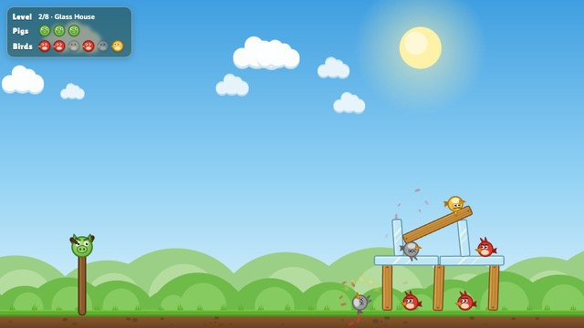<span>2. Glass House</span></a>
  <a href="games/angry-piggies-v2/index.html#3">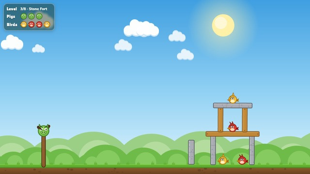<span>3. Stone Fort</span></a>
  <a href="games/angry-piggies-v2/index.html#4">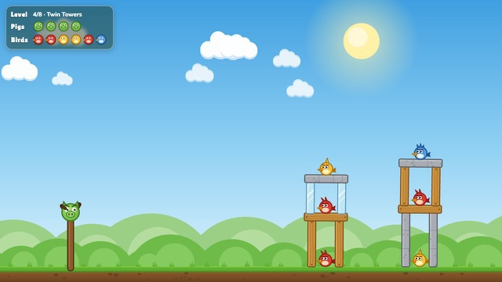<span>4. Twin Towers</span></a>
  <a href="games/angry-piggies-v2/index.html#5">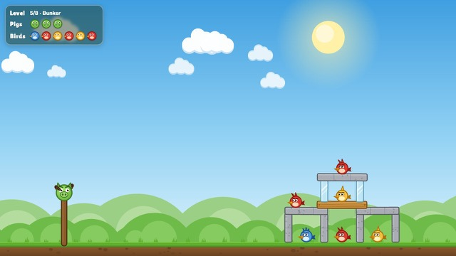<span>5. Bunker</span></a>
  <a href="games/angry-piggies-v2/index.html#6">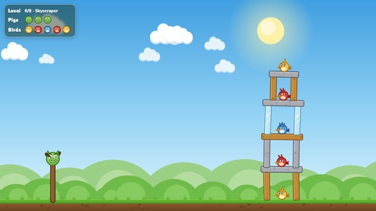<span>6. Skyscraper</span></a>
  <a href="games/angry-piggies-v2/index.html#7">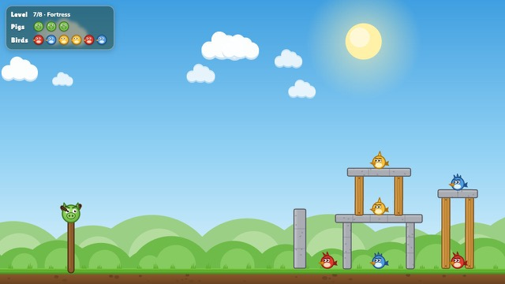<span>7. Fortress</span></a>
  <a href="games/angry-piggies-v2/index.html#8">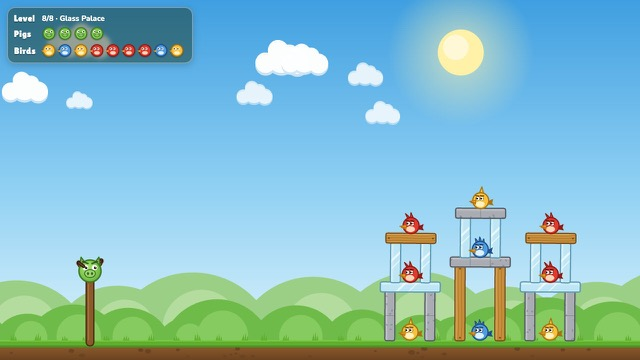<span>8. Glass Palace</span></a>
</div>

### What makes it harder

- **Three materials.** Glass breaks in one hit, wood in two, and stone takes three. Stone is also heavier, so it crushes whatever it falls on.
- **Three kinds of birds.** Red birds fall over easily, yellow ones need a falling block or a direct hit, and blue ones need a solid pig hit or heavy stone landing on them. If a bird gets stars around its head, you only dazed it.
- **Less help aiming.** The dotted aim line gets shorter on Level 7, and the last level, Glass Palace, has no aim line at all.
- **Bigger towers.** The levels go from one simple tower with 4 birds up to three towers with 9 birds and 4 pigs.

It also finally has a way to try again without refreshing. Clearing a level shows a **Next level** button, running out of pigs shows **Retry**, and pressing **R** restarts the level at any time.

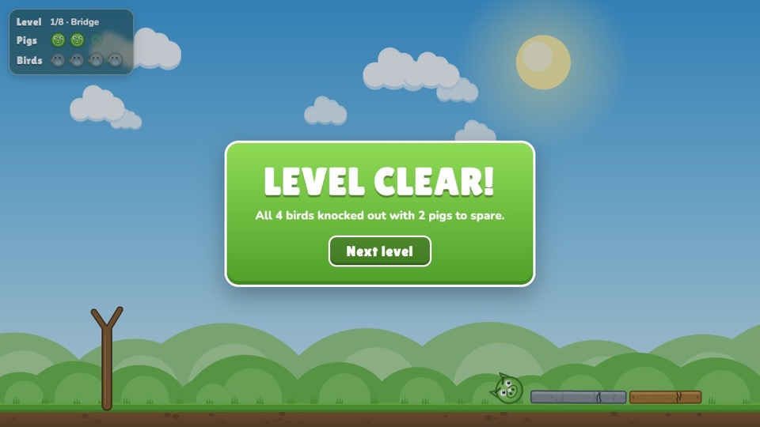

### A little bit of code

All 8 levels live in one list called `LEVELS` at the top of `game.js`. Each level is just a name, how many pigs you get, and where every block and bird goes:

```js
{
  name: 'Bridge', pigs: 3,
  blocks: [[-80, 60, 20, 120, 'wood'], [80, 60, 20, 120, 'wood'], ...],
  birds: [[-40, 16, 0], [40, 16, 0], ...]
}
```

Each block is `[x, y, width, height, material]` and each bird is `[x, y, type]`. That means making a new level doesn't take any new code, just a new entry in the list.

### What I found testing it

I loaded every level and left it alone without launching anything, to make sure each tower can stand on its own. Six of the eight do, but two don't:

- **Level 2, Glass House:** the tower falls apart before you even shoot and knocks out 5 of the 6 birds. The two glass beams in the middle overlap by 20 pixels, so the physics engine shoves them apart the second the level starts.
- **Level 6, Skyscraper:** the five-story tower collapses on its own and the game shows "Level Clear" with all 3 pigs unused. Nothing overlaps here, so the tower is most likely just too tall and top-heavy to stay standing.

The first two levels are also still beatable with a single good shot, which is fine for the opening levels since the difficulty ramps up after that.

### Next steps

1. **Fix Levels 2 and 6.** Separate the overlapping glass beams in Level 2, and make the Skyscraper sturdier (wider pillars or one less floor) so it stands until a pig hits it.
2. **Add a score.** This is the last goal from my list that's still open. Every bird and block should be worth points, so there's a reason to replay levels.
