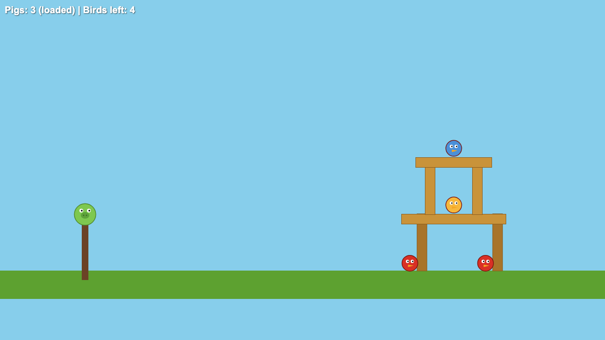

# 10-12-26 · One Shot Autopsy: Angry Piggies

## The Game

In class, we were given the goal to one-shot vibe code a game. I was immediately skeptical of the capabilities of AI being able to do that, as I am familiar with AI coding and I know that it takes a ton of planning for an AI to get it right. So, I gave it this prompt:

> Alright I need a game like angry birds, where you have a catapult and you launch something. Instead I want to throw a twist on it, I want it to be the piggies going at the birds instead of the other way around. I need this to be a one shot. I need simple features, simple slingshot that launches a round pig and a structure that has breaking physics. The structure will have the birds on it and the goal is to get them to fall, don't go to complicated keep it simple and focus on core game mechanics.

Looking back on it, I could have phrased it better for the AI to understand what I was saying, but we were just doing a quick one-shot, so not too much detail was included in the prompt.

## The Return

The AI came back with a single HTML file it called "Angry Piggies." It used Matter.js, a JavaScript physics library, to handle the slingshot, the tower, and the collisions. You get three pigs to launch at a two-level wooden tower with four birds on it, plus a small scoreboard and a win or game over message at the end.



[Play the game yourself](games/angry-piggies.html) (drag the pig back and let go to launch it).

<details markdown="1">
<summary>View the full code the AI returned</summary>

```html
<!DOCTYPE html>
<html lang="en">
<head>
<meta charset="UTF-8">
<meta name="viewport" content="width=device-width, initial-scale=1.0">
<title>Angry Piggies</title>
<style>
  html, body { margin: 0; padding: 0; overflow: hidden; background: #87CEEB; font-family: Arial, Helvetica, sans-serif; }
  #hud {
    position: absolute; top: 10px; left: 10px; color: #fff;
    font-size: 20px; font-weight: bold; text-shadow: 1px 1px 2px rgba(0,0,0,0.6);
    user-select: none; pointer-events: none;
  }
  #message {
    position: absolute; top: 40%; width: 100%; text-align: center;
    font-size: 48px; font-weight: bold; color: #fff;
    text-shadow: 2px 2px 4px rgba(0,0,0,0.7); display: none;
    user-select: none; pointer-events: none;
  }
</style>
</head>
<body>
<div id="hud"></div>
<div id="message"></div>
<script src="https://cdn.jsdelivr.net/npm/matter-js@0.19.0/build/matter.min.js"></script>
<script>
(function () {
  'use strict';

  const { Engine, Render, Runner, Bodies, Body, Composite, Constraint, Mouse, MouseConstraint, Events, Vector } = Matter;

  const WIDTH = window.innerWidth;
  const HEIGHT = window.innerHeight;
  const GROUND_Y = HEIGHT - 40;
  const SLING_X = 180;
  const SLING_Y = GROUND_Y - 140;
  const TOTAL_PIGS = 3;

  const engine = Engine.create();
  const world = engine.world;

  const render = Render.create({
    element: document.body,
    engine: engine,
    options: {
      width: WIDTH,
      height: HEIGHT,
      wireframes: false,
      background: '#87CEEB'
    }
  });
  Render.run(render);
  Runner.run(Runner.create(), engine);

  // --- Static scenery ---
  const ground = Bodies.rectangle(WIDTH / 2, GROUND_Y + 20, WIDTH * 2, 80, {
    isStatic: true,
    label: 'ground',
    render: { fillStyle: '#5da130' }
  });

  const slingPole = Bodies.rectangle(SLING_X, SLING_Y + 70, 14, 140, {
    isStatic: true,
    isSensor: true,
    render: { fillStyle: '#6b4226' }
  });

  Composite.add(world, [ground, slingPole]);

  // --- Pig (projectile) ---
  let pig = null;
  let sling = null;
  let pigsLeft = TOTAL_PIGS;
  let launched = false;

  function createPig() {
    pig = Bodies.circle(SLING_X, SLING_Y, 22, {
      label: 'pig',
      density: 0.006,
      restitution: 0.4,
      friction: 0.6,
      render: { fillStyle: '#7ec850', strokeStyle: '#4e8a2e', lineWidth: 3 }
    });
    sling = Constraint.create({
      pointA: { x: SLING_X, y: SLING_Y },
      bodyB: pig,
      stiffness: 0.05,
      damping: 0.02,
      length: 1,
      render: { strokeStyle: '#6b4226', lineWidth: 4 }
    });
    launched = false;
    Composite.add(world, [pig, sling]);
  }

  // --- Structure with breaking physics ---
  const blocks = [];
  function addBlock(x, y, w, h) {
    const block = Bodies.rectangle(x, y, w, h, {
      label: 'block',
      density: 0.002,
      friction: 0.8,
      restitution: 0.1,
      render: { fillStyle: '#c9933a', strokeStyle: '#8a5a1b', lineWidth: 2 }
    });
    block.hitPoints = 2;
    blocks.push(block);
    Composite.add(world, block);
    return block;
  }

  // --- Birds (targets) ---
  const birds = [];
  const birdColors = ['#d93025', '#f6b73c', '#4a90d9'];
  function addBird(x, y, colorIndex) {
    const bird = Bodies.circle(x, y, 16, {
      label: 'bird',
      density: 0.001,
      restitution: 0.3,
      friction: 0.5,
      render: { fillStyle: birdColors[colorIndex % birdColors.length], strokeStyle: '#7a1510', lineWidth: 3 }
    });
    bird.alive = true;
    birds.push(bird);
    Composite.add(world, bird);
    return bird;
  }

  function buildLevel() {
    const bx = WIDTH - 320;

    // Two towers with a bridge
    addBlock(bx - 80, GROUND_Y - 60, 20, 120);   // left pillar
    addBlock(bx + 80, GROUND_Y - 60, 20, 120);   // right pillar
    addBlock(bx, GROUND_Y - 130, 220, 20);       // bridge

    addBlock(bx - 50, GROUND_Y - 190, 20, 100);  // upper left pillar
    addBlock(bx + 50, GROUND_Y - 190, 20, 100);  // upper right pillar
    addBlock(bx, GROUND_Y - 250, 160, 20);       // roof

    addBird(bx - 80, GROUND_Y - 30, 0);          // ground bird (inside)
    addBird(bx + 80, GROUND_Y - 30, 0);
    addBird(bx, GROUND_Y - 160, 1);              // bridge bird
    addBird(bx, GROUND_Y - 280, 2);              // roof bird
  }

  buildLevel();
  createPig();

  // --- Mouse / slingshot control ---
  const mouse = Mouse.create(render.canvas);
  const mouseConstraint = MouseConstraint.create(engine, {
    mouse: mouse,
    constraint: { stiffness: 0.1, render: { visible: false } }
  });
  render.mouse = mouse;
  Composite.add(world, mouseConstraint);

  // Only allow dragging the current pig
  Events.on(mouseConstraint, 'startdrag', (e) => {
    if (e.body !== pig || launched) {
      mouseConstraint.constraint.bodyB = null;
    }
  });

  Events.on(mouseConstraint, 'enddrag', (e) => {
    if (e.body === pig && !launched) {
      const pull = Vector.magnitude(Vector.sub(pig.position, { x: SLING_X, y: SLING_Y }));
      if (pull > 15) {
        launched = true;
        pigsLeft--;
        // Release from sling shortly after so the elastic snaps the pig forward
        setTimeout(() => {
          sling.bodyB = null;
          Composite.remove(world, sling);
          scheduleNextPig();
        }, 60);
      }
    }
  });

  function scheduleNextPig() {
    setTimeout(() => {
      if (gameOver) return;
      if (pig) Composite.remove(world, pig);
      if (pigsLeft > 0) {
        createPig();
      } else {
        checkLose();
      }
    }, 3500);
  }

  // --- Collisions: break blocks, knock out birds ---
  Events.on(engine, 'collisionStart', (event) => {
    for (const pair of event.pairs) {
      const { bodyA, bodyB } = pair;

      // Block damage from hard impacts
      for (const [body, other] of [[bodyA, bodyB], [bodyB, bodyA]]) {
        if (body.label === 'block') {
          const impact = Vector.magnitude(Vector.sub(body.velocity, other.velocity)) * other.mass;
          if (impact > 25) {
            body.hitPoints--;
            body.render.fillStyle = body.hitPoints === 1 ? '#a8742a' : body.render.fillStyle;
            if (body.hitPoints <= 0) {
              Composite.remove(world, body);
            }
          }
        }
      }

      // Bird knocked out by pig hit or by falling to the ground
      for (const [body, other] of [[bodyA, bodyB], [bodyB, bodyA]]) {
        if (body.label === 'bird' && body.alive) {
          const hitByPig = other.label === 'pig';
          const hitGround = other.label === 'ground' && Vector.magnitude(body.velocity) > 3;
          if (hitByPig || hitGround) {
            knockOutBird(body);
          }
        }
      }
    }
  });

  function knockOutBird(bird) {
    bird.alive = false;
    bird.render.fillStyle = '#999';
    bird.render.strokeStyle = '#666';
    setTimeout(() => Composite.remove(world, bird), 1200);
    checkWin();
  }

  // --- Win / lose ---
  let gameOver = false;
  const messageEl = document.getElementById('message');
  const hudEl = document.getElementById('hud');

  function checkWin() {
    if (birds.every((b) => !b.alive)) {
      gameOver = true;
      messageEl.textContent = 'YOU WIN!';
      messageEl.style.display = 'block';
    }
  }

  function checkLose() {
    if (!gameOver && pigsLeft <= 0) {
      setTimeout(() => {
        if (!gameOver) {
          gameOver = true;
          messageEl.textContent = 'GAME OVER';
          messageEl.style.display = 'block';
        }
      }, 2000);
    }
  }

  // --- HUD + custom drawing (pig/bird faces, trajectory dots) ---
  const trail = [];

  Events.on(render, 'afterRender', () => {
    const ctx = render.context;
    const remaining = birds.filter((b) => b.alive).length;
    hudEl.textContent = `Pigs: ${pigsLeft}${!launched && pig ? ' (loaded)' : ''}  |  Birds left: ${remaining}`;

    // Trajectory trail
    if (pig && launched) {
      trail.push({ x: pig.position.x, y: pig.position.y });
      if (trail.length > 40) trail.shift();
    } else if (!launched) {
      trail.length = 0;
    }
    ctx.fillStyle = 'rgba(255,255,255,0.6)';
    for (let i = 0; i < trail.length; i += 3) {
      ctx.beginPath();
      ctx.arc(trail[i].x, trail[i].y, 3, 0, Math.PI * 2);
      ctx.fill();
    }

    // Pig face
    if (pig) drawPigFace(ctx, pig);

    // Bird faces
    for (const bird of birds) {
      if (Composite.get(world, bird.id, 'body')) drawBirdFace(ctx, bird);
    }
  });

  function drawPigFace(ctx, body) {
    const { x, y } = body.position;
    // Snout
    ctx.fillStyle = '#5ea33b';
    ctx.beginPath();
    ctx.ellipse(x, y + 2, 9, 7, 0, 0, Math.PI * 2);
    ctx.fill();
    ctx.fillStyle = '#3c6e24';
    ctx.beginPath();
    ctx.arc(x - 3, y + 2, 1.5, 0, Math.PI * 2);
    ctx.arc(x + 3, y + 2, 1.5, 0, Math.PI * 2);
    ctx.fill();
    // Eyes
    ctx.fillStyle = '#fff';
    ctx.beginPath();
    ctx.arc(x - 8, y - 8, 4, 0, Math.PI * 2);
    ctx.arc(x + 8, y - 8, 4, 0, Math.PI * 2);
    ctx.fill();
    ctx.fillStyle = '#000';
    ctx.beginPath();
    ctx.arc(x - 7, y - 8, 1.8, 0, Math.PI * 2);
    ctx.arc(x + 9, y - 8, 1.8, 0, Math.PI * 2);
    ctx.fill();
  }

  function drawBirdFace(ctx, body) {
    const { x, y } = body.position;
    // Eyes
    ctx.fillStyle = '#fff';
    ctx.beginPath();
    ctx.arc(x - 5, y - 4, 3.5, 0, Math.PI * 2);
    ctx.arc(x + 5, y - 4, 3.5, 0, Math.PI * 2);
    ctx.fill();
    ctx.fillStyle = '#000';
    ctx.beginPath();
    if (body.alive) {
      ctx.arc(x - 4, y - 4, 1.5, 0, Math.PI * 2);
      ctx.arc(x + 6, y - 4, 1.5, 0, Math.PI * 2);
      ctx.fill();
    } else {
      // X eyes
      ctx.strokeStyle = '#000';
      ctx.lineWidth = 1.5;
      for (const ex of [x - 5, x + 5]) {
        ctx.beginPath();
        ctx.moveTo(ex - 2, y - 6); ctx.lineTo(ex + 2, y - 2);
        ctx.moveTo(ex + 2, y - 6); ctx.lineTo(ex - 2, y - 2);
        ctx.stroke();
      }
    }
    // Beak
    ctx.fillStyle = '#f5a623';
    ctx.beginPath();
    ctx.moveTo(x - 4, y + 3);
    ctx.lineTo(x + 8, y + 5);
    ctx.lineTo(x - 4, y + 8);
    ctx.closePath();
    ctx.fill();
  }
})();
</script>
</body>
</html>
```

</details>

## What I Noticed

The game really struggled with physics. It had a good-looking GUI, but the slingshot mechanics and the breaking of the tower never worked the way they should. You can even see it in the screenshot above: the bottom pillars are already darkened, which is how the game shows a damaged block, before a single pig has been launched.

That lined up with what I expected going in. AI isn't at the point yet where it can take one prompt and build a whole working game from it. To get something like this right, it either needs a lot of context and clear limits to keep it focused on what you actually want, or it needs real planning done ahead of time, before any code gets written. A one-shot skips both of those, so you end up with something that looks finished on the surface but falls apart once you actually play it.
